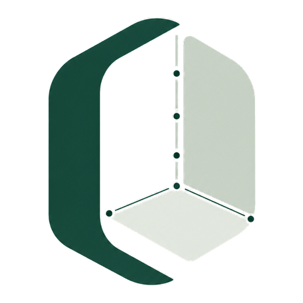

# Oasis-spaces — website

The public site for Oasis-spaces: *Film your room once. Redesign it in 3D.*

Plain HTML, CSS and JavaScript, no build step. The three 3D previews (the
room assembling from scan points, the drag-and-drop editor, the before/after
redesign) are built from primitives in metres with Three.js, loaded from
jsdelivr — there are no model files.

## Run locally

    python3 -m http.server 8735

then open http://localhost:8735.

## Room planner (Python backend)

`planner/` is a to-scale floor-plan page backed by a Python server in `server/`
(standard library only, nothing to install):

    python3 server/app.py        # http://localhost:8735/planner/
    python3 -m unittest discover -s tests

The server also serves the rest of the site, so it replaces `http.server`
above. `server/planner.py` does the geometry: collision and wall checks, door
swing, a flood-fill walkability test from the doorway, paint/flooring/cost
estimates and a greedy auto-arranger. `/api/arrange` streams each placement as
Server-Sent Events. The server validates input, caps request size, rate-limits
per client, sends a CSP, and serves only whitelisted static files.

Render's static site (below) cannot run Python, so `/planner/` needs a Render
Web Service (`python3 server/app.py`, honours `PORT`) to work in production.

## Deploy

Hosted on Render as a free static site from `render.yaml` (publish path `.`,
nothing to build). Every push to `main` deploys.

## Logo

`logo.png` is the master (1254 px, on its own off-white ground). `logo-mark.png`
is the transparent cutout used in the header and footer; `icons/`,
`apple-touch-icon.png` and `og-image.png` are generated from it for favicons,
the home-screen icon (`site.webmanifest`) and link previews.

## Health check

`/health` (also `/health.json`) returns `{"status":"ok"}` with HTTP 200 — point
uptime monitors at it.

## Suggestion box

The form at the bottom opens the visitor's mail app addressed to
contact@oasis-spaces.info. To collect suggestions without a mail app, set
`SUGGEST_ENDPOINT` in `main.js` to a form service that forwards to that address.
